 

### 👋 Olá, eu sou o Guilherme

Estudo **Engenharia de Software** e atuo com **suporte SAP**. Gosto de transformar problemas de negócio em sistemas claros, funcionais e agradáveis de usar. Estou explorando desenvolvimento, UX/UI, infraestrutura, redes e segurança.

> **Meu norte:** software útil, interfaces cuidadosas e sistemas bem conectados.

---

### 🧩 O que estou construindo

**🛡️ DOKKAEBI / NOEL HO HOME** `em desenvolvimento`  
Ecossistema pessoal de automação e monitoramento residencial: painel, câmeras, sensores e protocolos de segurança. A implementação ainda não está pública.

**🎬 SEVEN7MOTION** `em estruturação`  
Minha iniciativa de criação digital e desenvolvimento de aplicações, de landing pages a produtos próprios.

**🧪 Laboratório de código** `publicado`  
[Front-end](https://github.com/Goliver7/Front-end) · [Estruturas de dados](https://github.com/Goliver7/atv-estrutura-de-dados)

---

### ⚡ Stack & interesses

**Uso e pratico**

**Aprendendo e explorando**

`ABAP`  →  `APIs`  →  `UX/UI & acessibilidade`  →  `redes & servidores`  →  `segurança`

Mais sobre a minha direção técnica

 
Atuo na interseção entre sistemas empresariais e desenvolvimento. Em projetos pessoais, experimento redes, câmeras IP e automação. Gosto da clareza e do cuidado visual das interfaces do ecossistema Apple.

---

### 🤝 Meus parceiros de criação

Ferramentas que uso para pensar, pesquisar e construir. Claude e ChatGPT são marcas de seus respectivos proprietários.

---

<strong>BUILD · LEARN · REFINE</strong>

