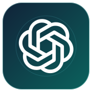

 

## ⚡ Tecnologias e linguagens

**Sistemas e dados**

**Código e interfaces**

**Aprofundando agora:** `ABAP (início)` · `APIs` · `UX/UI e acessibilidade` · `redes e servidores` · `segurança`

 

## 👤 Sobre mim

Estudo **Engenharia de Software**. Minha trajetória inclui **quatro anos no Grupo Abrascort**, onde comecei na área administrativa e migrei para TI. Tenho **cerca de dois anos de atuação em tecnologia**, com foco em suporte SAP, acessos, análise de problemas e documentação. Fora do trabalho, desenvolvo projetos pessoais em software, automação, infraestrutura e criação digital.

 

**Engenharia de Software · suporte SAP · produtos digitais**

Construo projetos próprios que conectam software, infraestrutura e experiência de uso. Gosto da clareza e dos detalhes das interfaces Apple, especialmente quando aplicados a produtos de tema escuro.

**Meus melhores amigos:**  

Clawd e ChatGPT são marcas de seus proprietários. Uso as ferramentas em projetos pessoais; não tenho afiliação com Anthropic ou OpenAI.

 

## 🛡️ DOKKAEBI

 

**Uma casa que percebe, organiza e responde.** O DOKKAEBI é meu ecossistema de segurança residencial inteligente. A proposta é reunir câmeras, sensores, automações e histórico de eventos em uma experiência compreensível: o que aconteceu, onde, quando e qual resposta é apropriada.

| Frente | Papel no ecossistema |
| :-- | :-- |
| **VALKYRIE** | Servidor, rede, câmeras IP, instalação, armazenamento e integração dos equipamentos. |
| **DOKKAEBI CORE** | Plataforma de software: painéis, APIs, eventos, usuários, permissões, regras e futuras integrações de IA. |
| **NOEL HO HOME** | Implantação piloto na residência da minha família, para testar fluxos e validar a operação real. |

Na experiência planejada, o painel reúne câmeras, sensores e alertas. O **IRON HOME** deverá reforçar a proteção quando a ausência dos moradores for confirmada; o **HELP MODE** propõe etapas de confirmação para possíveis emergências. O modo TV foi pensado para alternar entre o acompanhamento do projeto e a visão operacional da casa. Alertas pelo Telegram e integração com o ambiente doméstico fazem parte do caminho.

> **Agora:** a interface e a arquitetura estão em desenvolvimento. Câmeras adicionais, sensores, automações e a implantação completa ainda exigem validação. A possibilidade de transformar o piloto em produto comercial vem depois dos testes.

 

## 🎬 SEVEN7MOTION

 

**Uma ideia pode virar narrativa, interface ou produto.** A SEVEN7MOTION é minha iniciativa para unir comunicação digital e desenvolvimento de software. Na criação de conteúdo, trabalho com captação, direção, edição de vídeos curtos, cobertura de eventos, peças visuais e presença em redes sociais. Na frente de tecnologia, exploro páginas, sites, automações, aplicações e, no futuro, produtos próprios.

O número **7** orienta a identidade: um símbolo que pode lembrar enquadramento, lente e movimento. Quero que cada entrega tenha propósito, ritmo, clareza e uma experiência coerente — da primeira imagem de um vídeo à última tela de uma aplicação.

> **Agora:** serviços criativos e estrutura do portfólio estão em desenvolvimento. As aplicações e produtos de software são uma direção de expansão, não lançamentos já concluídos.

 

## 🧪 Código e experimentos

Alguns estudos já estão públicos: [front-end](https://github.com/Goliver7/Front-end) · [estruturas de dados](https://github.com/Goliver7/atv-estrutura-de-dados). Também desenvolvo projetos com amigos; eles estão em andamento e serão apresentados quando fizer sentido. Os projetos acima terão repositórios e demonstrações conforme amadurecerem.

 CONSTRUIR · APRENDER · REFINAR

